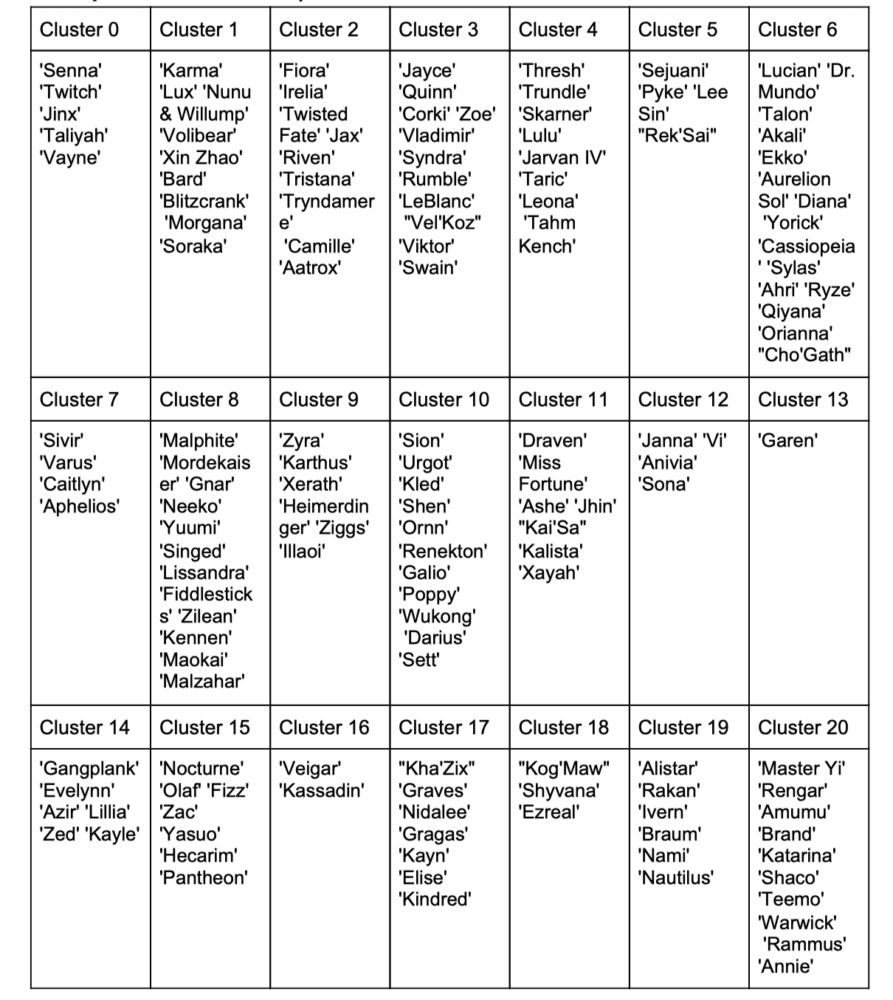

A Columbia University course team project from 2020, comparing match prediction models and grouping champions by their performance. The figures come from the original final report. Models have not been retrained for this revisit.

## Prediction tasks

| Task | Inputs | Result |
|---|---|---|
| Match-statistics prediction | Gold, kills and objectives, including post-match information | Approximately 97–99% test accuracy |
| Composition prediction | Counts of champion groups selected by each side | Approximately 52–56% test accuracy |

The first task includes information available only late in or after the match, which helps explain its high accuracy. A pre-match model needs to remove those fields and be evaluated again.

## Data preparation

The source was Oracle's Elixir's 2020 professional match data: 77,424 rows and 105 columns. A match normally includes ten player rows and two team rows.

Team records were combined by match, leaving 6,369 matches after cleaning. Player statistics were aggregated by champion for dimensionality reduction and clustering.

## Champion clusters

The team aggregated 54 features separately in wins and losses to produce 108 features. Four principal components retained 94.05% of variance, followed by K-Means clustering.

The final report selected 20 regular clusters plus fallback label 20 for champions outside those clusters. The encoding therefore has 21 positions. Summing the five one-hot vectors per team and concatenating both sides produces 42 composition features.

The repository contains multiple experiments. The win/loss grouping section in `pca_cluster.py` uses ten groups; this page follows the final report and Appendix B's 20-plus-one definition.

## Model results

Test accuracy recorded on pages 3–4 of the final report:

| Model | Match statistics, including post-match information | Composition |
|---|---:|---:|
| Lasso logistic regression | 98.81% | 53.74% |
| Decision tree | 98.18% | — |
| SVM | 99.13% | 51.85% |
| KNN | 96.86% | 52.79% |
| Random forest | 99.06% | 54.17% |
| Neural network | 98.74% | 56.17% |

The composition model retains group counts rather than individual champions, positions or pick order. Results use a single random split, so differences between models still need stability checks.

## Evaluation improvements

- Define separate pre-match, ten-minute and fifteen-minute tasks, each using information available at that time.
- Hold out matches by time or patch. Fit champion aggregates, scaling, PCA and clustering inside the training window.
- Add roles, champion identities, patches, teams and player history. Compare a team-strength baseline with the added value of composition.
- Compare multiple time windows using AUC, log loss and probability calibration. Report sample sizes and uncertainty for sparse matchups.

## Group matchups

The project also counted historical win rates between champion groups to explore alternatives during pick/ban. Those counts are affected by teams, players, patches and sample sizes. Assessing a pick's effect requires additional controls.

## Materials

- [Repository](https://github.com/alubanana/League_of_League_Ban_Pick_Analysis)
- [Final report](https://github.com/alubanana/League_of_League_Ban_Pick_Analysis/blob/master/BA_Final_Project_Report_Group7.pdf)
- [PCA and clustering](https://github.com/alubanana/League_of_League_Ban_Pick_Analysis/blob/master/Code%20%26%20Data/pca_cluster.py)
- [R models](https://github.com/alubanana/League_of_League_Ban_Pick_Analysis/blob/master/Code%20%26%20Data/BA%20project%20predicting%20models.R) and [classification notebook](https://github.com/alubanana/League_of_League_Ban_Pick_Analysis/blob/master/Code%20%26%20Data/Prediction_model_SVM_KNN_NN.ipynb)
- [Full original article and Chinese translation](__ORIGINAL_LOL_URL__)
