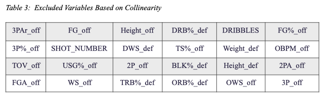

- [GitHub 仓库](https://github.com/alubanana/NBA_Shot_Prediction)

## 项目概览

本项目的目标是结合投篮及其发生情境的数据分析，建立预测球员投篮命中或未命中的模型，帮助相关参与者制定更有效的比赛策略。建模时，我们希望找到准确率和 F1 分数最高的模型。


## 数据理解与准备

本节先介绍原始数据集及其准备过程，再通过探索性数据分析（EDA）展示合并后数据集的特点。

原始数据来自 Kaggle，记录了 NBA 2014—2015 赛季的全部投篮尝试，由 Kaggle 数据科学家“DanB”上传，原始资料取自 NBA 的 REST API。目标变量为“Shot Result”，即投篮命中（“made”）或未命中（“missed”）。数据共有 128,069 条观测（每条对应一次投篮），每次投篮包含 20 个描述其特点的变量。数据完整程度较高，但球员信息不够深入，因此我们决定再寻找一个包含球员个人资料的数据集。

[原始数据集](https://www.kaggle.com/dansbecker/nba-shot-logs)

### 数据准备步骤

我们按照 5 个必要的数据准备步骤构建所需数据集。首先，从 Kaggle1 收集 NBA 球员赛季数据，使用 Excel 的 Vlookup，将原始数据中的“Closest Defender’s Name”（最近防守球员姓名）和“Player”（球员）关联到各自的赛季数据。其次，删除 70 个我们认为不必要的变量，如防守球员的进攻变量、进攻球员的防守变量。然后，重命名预测变量字段，以便进行数据合并，将相应球员资料匹配到投篮记录。最后，删除被识别为异常值的记录，完成数据抽样。最终数据集有 **127,951 条观测、46 个变量**。

### 通过可视化理解数据

本节使用不同的可视化方式，展示两项或少量属性之间的关系。

- 箱线图

箱线图展示球员身高与场上位置的关系。直观上，中锋通常是对手进攻时的最后一道防线，因此需要较高的身材；控球后卫通常负责持球，需要相对较小的体型以便在场上灵活移动。


- 分布图

图 2 展示投篮距离的分布。大部分投篮集中在篮筐附近或三分线附近（7.24 m），这一规律符合直觉：球员要么靠近篮筐，以提高命中概率；要么在三分线外出手，以争取更多得分。


- 小提琴图

上面的小提琴图展示不同位置球员的投篮距离与投篮结果之间的关系。

- Tableau 可视化

在 Tableau 中，我们分别绘制了投篮命中总数和平均命中情况随投篮距离的变化。命中次数集中在前述两个区域，也能看到一些有趣的异常点。例如，在 14.39 米的距离上，仅有 John Wall 的一次投篮命中。总体而言，离篮筐最近时，投篮成功率最高。


## 建模

我们使用**逻辑回归、决策树**和**随机森林**模型。目标变量为类别变量，任务是预测一次投篮是否命中。项目采用两种变量选择标准，并比较结果：第一种依据直觉、共线性和 p 值；第二种采用 William Koehrsen 开发的特征选择方法。

### 第一轮变量选择

总共有 45 个解释变量。对 NBA 比赛有一定了解的观众，可以发现其中一些特征与出手结果关系不大。例如，衡量进攻球员能力时，其盖帽率和篮板率似乎对投篮结果不太重要；而防守球员的三分命中率，可能也无法有效解释他能否干扰对方投篮。因此，我们先删除了 23 个被认为影响较小的变量，在模型中保留 22 个自变量。其中，9 个变量描述进攻球员（如命中率、身高），9 个描述防守球员（如进攻者与防守者的距离、篮板率），4 个描述投篮的其他属性（如进攻时限、投篮距离）。变量详情见下表。


我们首次运行三个模型时，发现逻辑回归结果不理想，部分变量的 p 值过高，未达到显著水平；决策树和随机森林的准确率也较低。为进一步缩减变量，我们分别绘制防守球员和进攻球员变量的热力图，观察相关性。根据热力图继续删除变量，最后保留的相关变量为：“Dribbles”、“Shot-Dis”、“Shot-Clock”、“Close_Def_Dist”、“Height_def”、“BLK_def”、“Age_off”、“OBMP_off”和“FG_off”。


我们使用上述全部变量，分别运行决策树和随机森林。结果如前图所示，随机森林的准确率和 F1 分数明显高于决策树。对于决策树，我们考察了各变量的重要性；对于随机森林，分别尝试了 100、200、300 和 400，发现 400 时的准确率和 F1 分数最高。

### 特征选择模型

为检验凭直觉选择变量是否合理，我们找到一个发布在 GitHub 上、同样用于选择最合适特征的模型。除 sklearn 外，该模型还使用了“LightGBM”统计库中的梯度提升机。具体机制见名为“Feature Selector Development”和“Feature Selector Usage”的 Jupyter Notebook 文件。

William 开发的特征选择模型包含以下五项标准：

1. 删除缺失比例高于指定阈值的变量。
2. 删除仅有一个唯一值的变量。
3. 删除相关系数高于给定值的变量。
4. 根据梯度提升机，删除重要性为 0 的变量。
5. 根据梯度提升机，删除对达到指定累计特征重要性没有贡献的变量。

我们在数据清洗时，已用联盟平均数据替换缺失值。由于每次投篮的属性有所不同，也不存在只有一个唯一值的变量。这两项情况见图 5。因此，前两项标准均未删除变量。

 

两个高度相关的变量可能掩盖彼此的作用，因此只需保留其中一个。与此前使用的热力图类似，William 的模型允许设置相关系数阈值，删除超过该值的变量。我们将相关系数上限设为 0.6，也就是删除相关系数高于 0.6 的特征。图 6 展示全部变量的相关性，以及相关系数高于 0.6 的变量。在这一步中，共删除 24 个超过阈值的变量（表 3）。图 7 以示例展示相关系数，以及应保留或删除的变量。




第四、第五项标准建立在监督机器学习模型上，利用 LightGBM 的梯度提升机估计特征重要性，再据此删除变量。两步分别删除重要性为 0 的特征，以及未被纳入累计 95% 重要性范围的变量。梯度提升训练过程见图 8。建模后，所有变量的重要性均为正；达到 0.95 的累计重要性需要 36 个变量。表 4 展示重要性最高的 12 个变量，以及这 36 个变量如何累计达到 0.95。其余变量为 '3P_off'、'PERIOD'、'TOV_off'、'Height_off'、'2PA_off'、'FGA_off'、'PTS_off'、'3PA_off'、‘HOME’，它们对预测投篮结果的贡献相对较小，因此被删除。


低重要性变量可能与高相关变量重叠，因此特征选择模型总共删除了 26 个变量：'HOME'、‘FG_off’、‘Height_off'、'DRB_def'、‘FG_off'、'eFG_off'、'TOUCH_TIME'、'2P_off'、'Weight_def'、'OBPM_off'、'WS_def'、'TOV_off'、'2P_off'、'BLK_def'、'2PA_off'、'FGA_off'、'WS_off'、'3PA_off'、‘TRB_def'、'DBPM_def'、'ORB_def'、'PERIOD'、'OWS_off'、‘Weight_off' 和 ‘3P_off'。我们对保留下来的特征分别使用逻辑回归、决策树和随机森林，以进一步分析直觉选变量与模型选变量是否会产生明显不同的结果。

### 进一步选择变量

除前文依据重要性、共线性和 p 值选择变量外，还可以使用递归特征消除（RFE），检查模型中是否仍有可删除的变量。RFE 模型显示，所有变量的标签均为“TRUE”，意味着无需移除任何变量。

```{python}
rfe = RFE(model,19)
rfe = rfe.fit(X_train, y_train.ravel()
print(rfe.support_)
print(rfe.ranking)
```


逐步回归也是寻找合适特征的方法，可以通过后向消除（从包含全部特征的模型中删除变量）或前向选择（从空模型中加入变量）完成。然而，受篇幅限制，本报告不包含该方法。如果篇幅允许，研究者可以使用逐步回归，检验不同变量组合能否形成更好的模型。

## 结果与评估

### 第一种变量选择方法的结果

业务目标是尽可能准确地预测一次投篮是否命中，因此需要对模型准确率进行排序和比较。我们计算了逻辑回归、决策树和随机森林的准确率与 F1 分数，比较三个模型的精确率和 F1 分数。逻辑回归的准确率高于决策树，与随机森林接近；其 F1 分数也最高。因此，在本情境下，逻辑回归是最准确的选择。


在决策树分析中，重要性最高的变量为投篮距离（0.14），其次是进攻时限（0.11），再其次是最近防守球员距离（0.1）。决定性变量并非球员自身属性。可能的原因是模型使用了整个 NBA 的数据，衡量的更接近平均球员的能力；因此，在平均水平上，个人技能的差异并不那么重要，更重要的是出手时的情境。这一分析可以帮助教练和球员寻找比赛策略，充分发挥每个人的潜力。

### 特征选择模型的结果

随后，我们对按特征选择模型五项标准筛出的变量，分别运行逻辑回归、决策树和随机森林，结果如下。


从结果可以看到，逻辑回归的准确率和 F1 分数在三个模型中最高。依据特征选择模型得到的结果，与依据直觉和相关性选择变量得到的结果也非常接近。

### 结果评估

上述六组预测结果显示，两个决策树模型都比另外两种模型表现差，可能是因为纳入变量过多，引入了过拟合。随机森林通过设置多棵树共同预测，使准确率和 F1 分数有所改善。不过，逻辑回归的混淆矩阵与随机森林接近，F1 分数甚至略高，而且更容易放在 NBA 的实际情境中解释。例如，使用第一种选择方法保留的 9 个变量的平均数据，可以预测球员此次投篮的命中概率为 44.08%。

然而，无论采用哪种变量选择方法，最佳预测结果仍局限在约 0.61 的准确率和 0.52。凭直觉选择变量与 William 的特征选择模型之间差异很小。一个可能的解释是：虽然纳入变量的数量不同，两个模型都保留了重要性最高的变量，如“SHOT_DIS”（投篮距离）、“CLOSE_DEF_DIST”（防守者与出手球员的距离）等，而这些正是决定预测结果的因素。

两种变量选择方法下的预测表现都远未令人满意。我们认为，数据限制是重要原因之一。现有数据只有一维的投篮距离，而投篮情境需要包含出手位置和出手高度的三维信息。此外，我们尝试用赛季数据预测球员在某一场具体比赛中的表现，但球员表现并非恒定，波动在 NBA 球员中很常见。最后，我们忽略了球队层面的影响，而这恰恰是球场上最重要的部分。篮球从来不只是一次一对一较量，团队凝聚力、士气和战术却很难由这些数据衡量。

## 建议、挑战与应对

### 球队战术设计

尽管每位球员各有强弱项，NBA 球员总体都具备很高水平，因此技能差异与一次投篮成功或失败的相关性不高。相比集中精力打磨和提高个人技术，更重要的是制定协调一致的球队战术。

教练可以在赛前使用模型设计战术，并为球队留出练习这些战术的时间，以提高获胜机会。这一建议的难点在于教练与球员需要权衡训练时间。面对许多需要优先处理的事项，教练未必有时间使用模型制定战术。这些专注团队战术的收益难以证明，因此他们也可能看不到这样做的必要性或优势。球员在运动中更容易顺着本能行动，而非处理信息，因此也很难严格遵循某种特定策略。球员表现还会受多种因素影响，进一步降低模型的准确性和有效性。

为了进一步说服相关参与者，可以验证模型的有效性。未来也值得纳入最近赛季的数据，以及更细致的球员信息，如惯用左手或右手、个人状态等。

### 重视球队士气

为了充分发挥球员表现，也需要让每个人处于良好的身体和心理状态，提高超出平常水平的机会。因此，赛前兼顾训练与能够提升球队士气的休闲活动，也是可采用的策略。

教练可以在赛前安排更多团队建设或社交活动，以增加获胜机会。难点同样是牺牲训练时间的权衡，以及这些取舍的收益难以预见。另一个挑战在于，竞技体育的魅力本就来自创造不可能的可能性；如果体育比赛不再有奇迹，我们也会失去追逐奇迹带来的乐趣。
